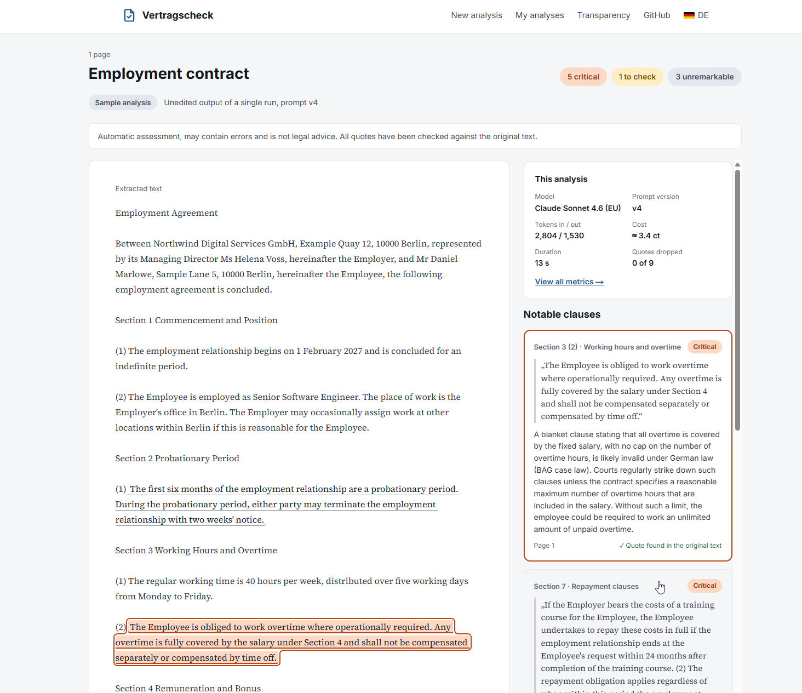
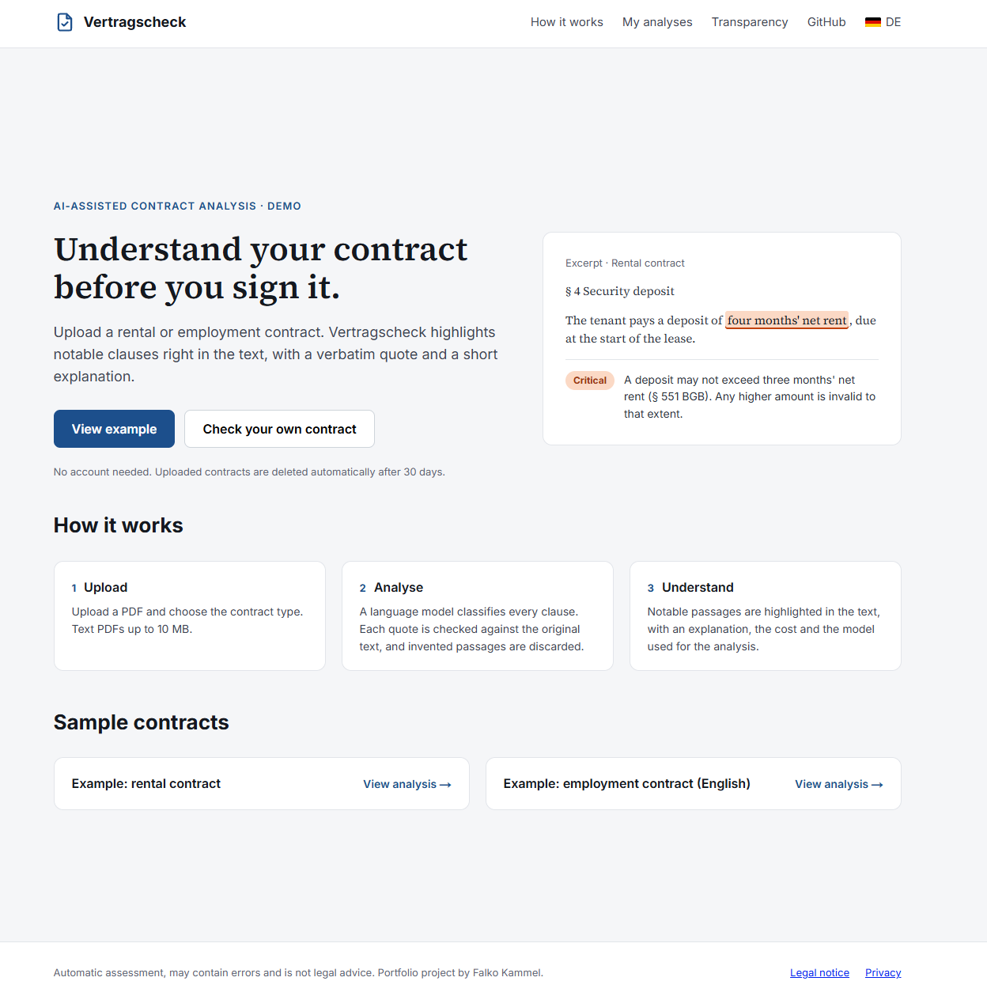
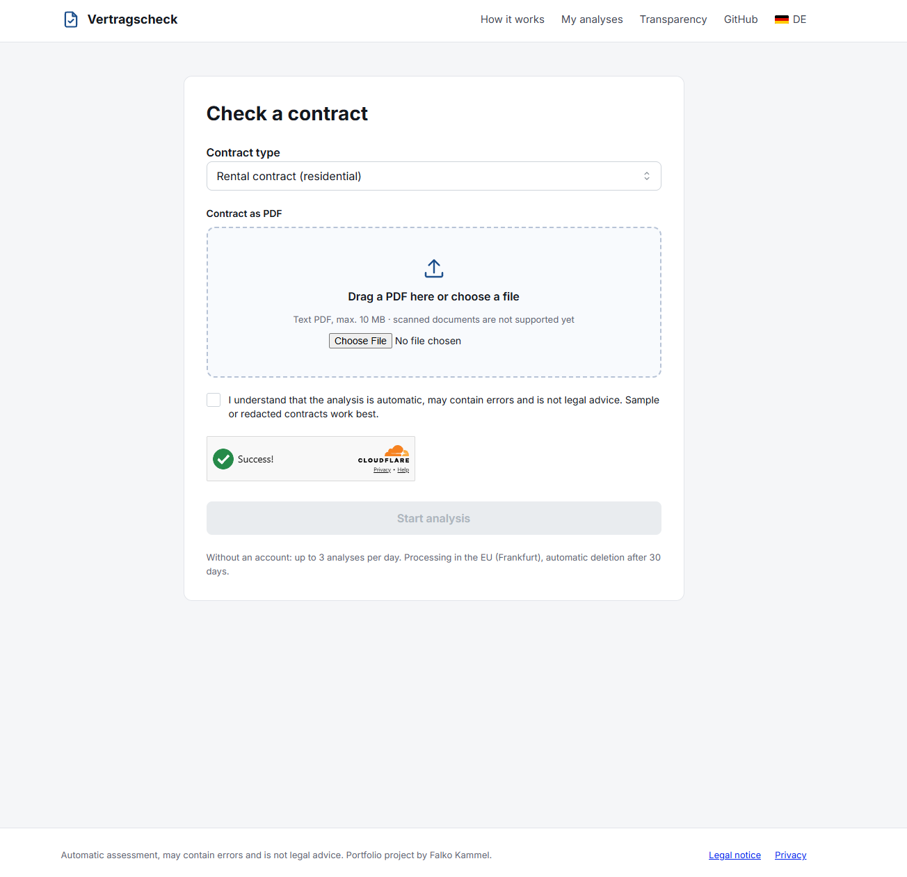
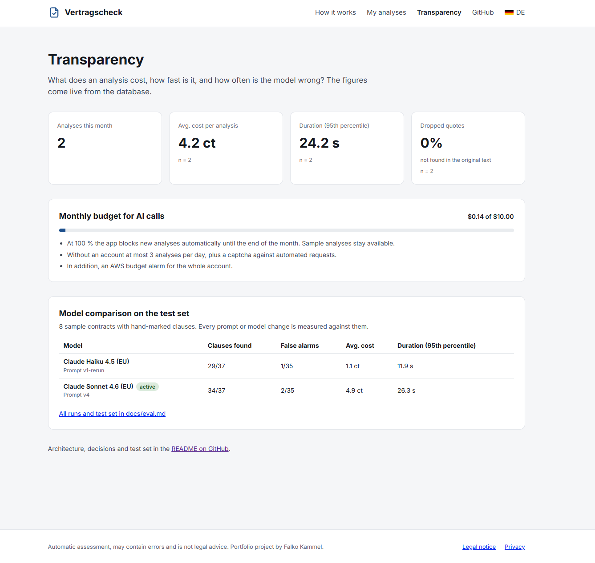
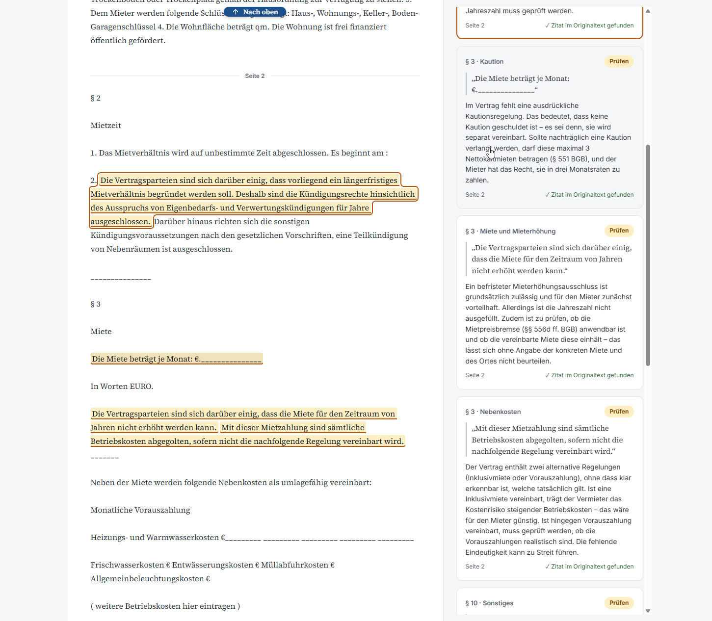
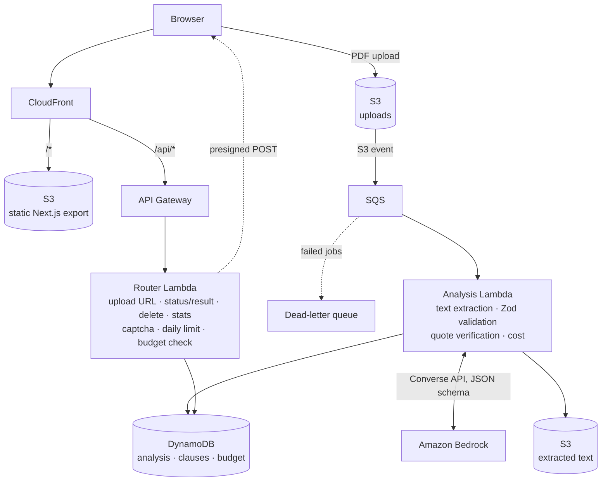

# Vertragscheck

Upload a German rental or employment contract and get notable clauses highlighted in the text, each with a verbatim quote, a short explanation and a traffic-light rating, plus the cost and error rate of the analysis shown openly.

**Live:** https://d1agi8t0w2viih.cloudfront.net/de (German, `/en` for English)

**Sample analyses (no upload needed):**
[rental contract](https://d1agi8t0w2viih.cloudfront.net/de/result?id=sample-rental) ·
[employment contract (English)](https://d1agi8t0w2viih.cloudfront.net/en/result?id=sample-employment)



| Start                                     | Upload                                      |
| ----------------------------------------- | ------------------------------------------- |
|  |  |

| Transparency                                            | Result (German)                                          |
| ------------------------------------------------------- | -------------------------------------------------------- |
|  |  |

## Disclaimer

The analysis is an automated first assessment and may contain errors. It is general information, not legal advice. The legal assessment is based on German law. This is a free, rate-limited demo; please use sample or redacted contracts.

## How it works

1. You choose the contract type (rental or employment) and upload a text-based PDF (up to 10 MB, up to 30 pages). The browser uploads it straight to S3 with a presigned POST.
2. An S3 event goes to SQS. The analysis Lambda extracts the text, stores it in S3 and deletes the PDF.
3. The text goes to Amazon Bedrock (Converse API, fixed JSON schema). The answer is validated with Zod and treated as untrusted.
4. Every clause needs a verbatim quote. Code looks for it in the extracted text; quotes that are not found are dropped and counted.
5. One DynamoDB item per analysis holds clauses, tokens, cost and duration. The frontend polls the status and renders the text with highlights.



Details and data model: [`docs/PLAN.md`](docs/PLAN.md).

## Tech stack

- **Frontend:** Next.js (App Router, static export), React, Mantine, `next-intl` (de/en), TanStack Query
- **Backend:** AWS Lambda (Node 24, TypeScript `strict`, no `any`), API Gateway, SQS, S3, DynamoDB (single table, 30-day TTL), AWS SDK v3, Zod at every boundary
- **LLM:** Amazon Bedrock Converse API, EU inference profile, model ID from config. Production: Claude Sonnet 4.6
- **Infra:** AWS CDK v2 in TypeScript, `eu-central-1`, CloudFront in front of S3 and API Gateway
- **Captcha:** Cloudflare Turnstile
- **Tooling:** pnpm workspaces, Vitest, ESLint, Prettier, GitHub Actions

## Evaluation

The test set has 8 synthetic contracts (4 rental, 4 employment) with hand-labelled clauses: 37 problem clauses and 35 clean ones. A returned clause counts as found when it overlaps a labelled span. "False alarms" are clean passages rated `check` or `critical`. Every prompt or model change is run through the same code path as production; raw results are committed and can be re-graded.

| Model                          | Prompt | Runs per contract | Recall         | Level accuracy | False alarms | Cost per analysis | p95 latency |
| ------------------------------ | ------ | ----------------- | -------------- | -------------- | ------------ | ----------------- | ----------- |
| Claude Haiku 4.5               | v1     | 1                 | 78 % (29/37)   | 93 % (27/29)   | 3 % (1/35)   | $0.0109           | 11.9 s      |
| Claude Sonnet 4.6              | v1     | 1                 | 92 % (34/37)   | 97 % (33/34)   | 9 % (3/35)   | $0.0471           | 26.2 s      |
| Claude Sonnet 4.6 (production) | v4     | 3                 | 92 % (102/111) | 96 % (98/102)  | 6 % (6/105)  | $0.0487           | 26.3 s      |

Recall is the share of labelled problem clauses that were found, level accuracy the share of found clauses with the correct traffic-light level. With 8 contracts every figure rests on small counts, so treat them as indications. Sonnet found most problems Haiku missed with every prompt variant, so I chose it despite the higher cost and latency. Prompt versions v2 and v3 (Haiku) were not adopted.

Full runs, per-contract misses and findings: [`docs/eval.md`](docs/eval.md).

## Key decisions

All entries with context and trade-offs are in [`docs/decisions.md`](docs/decisions.md). The main ones:

- Serverless instead of containers (001) and asynchronous analysis via S3 → SQS (002)
- DynamoDB single table, clauses embedded in the analysis item (003)
- No login; access by secret link, early deletion by token (004, 013)
- Monthly budget counted in the app with automatic block (005)
- Static Next.js export on S3 + CloudFront instead of SSR on ECS (006)
- Structured output, Zod validation and quote verification (008)
- Highlighting in the extracted text, not in the PDF (009)
- Lightweight clean architecture in the backend (011)
- Direct browser upload with a presigned POST (018) and idempotent analysis (019)
- Sonnet 4.6 as production model, based on the eval (033)

## Privacy and security

- No accounts. A result is reachable only through its random ID (a UUID) in the link and is never listed publicly.
- The browser keeps its own list of analyses and delete tokens in `localStorage`; the file name never leaves the browser. Only a hash of the delete token is stored on the server.
- The PDF is deleted right after text extraction. Extracted text and analysis are deleted after 30 days (S3 lifecycle, DynamoDB TTL), or earlier with the delete token.
- Processing stays in the EU (Bedrock EU inference profile, `eu-central-1`), data is encrypted at rest.
- Logs contain IDs, durations and token counts, never contract content.
- The client IP is not stored; the daily limit uses an HMAC of it.
- The presigned upload only allows one key, PDF content type and a size limit enforced by S3. The Lambda additionally checks the PDF signature and page count.
- Secrets live outside the repository; the Turnstile site key is the only captcha value in the build.

## Cost and limits

- 3 analyses per client and day, a captcha on every upload, 10 MB and 30 pages per PDF.
- Monthly budget of $10 for AI calls, counted per analysis from the token usage. At 100 % new analyses are refused until the month ends; sample analyses keep working.
- Concurrency of the analysis Lambda is capped at 2 and failed jobs are retried at most 3 times.
- With Sonnet 4.6 the budget covers about 212 analyses per month (decision 033, based on $0.047 per analysis in the eval). The [transparency page](https://d1agi8t0w2viih.cloudfront.net/en/transparency) shows live figures.

## Known limitations

- Only text-based PDFs. Scanned documents fail because there is no OCR.
- Text extraction loses layout, so paragraph numbers and line breaks can look different from the PDF. The result page shows extracted text, not the original PDF.
- Quote verification proves a quote exists in the contract, not that the legal assessment is right. Recall on the test set is 92 %, so some problem clauses are missed (for example a termination waiver of more than four years, inspections without cause, and a double written-form clause), and the model rates some harmless clauses as `check`.
- Missing clauses (for example no rule on minor repairs) cannot be reported, because every finding needs a quote.
- Test set is small, synthetic and German-law only.
- Only rental and employment contracts.
- The daily limit is a soft limit (a new network gets around it); the monthly budget is the hard ceiling.
- Early deletion works only in the browser that created the analysis; elsewhere the 30-day expiry applies.
- The AWS-level budget action as a second backstop is not built yet.
- The pricing table for the cost calculation is maintained by hand.

## Roadmap

Ordered by value; the first three follow directly from the eval findings.

1. Citations API or sentence IDs instead of free-text quotes, so a wrong quote is technically impossible.
2. Missing provisions as their own finding type (for example "no rule on minor repairs"), with a hint instead of a quote.
3. Prompt calibration for known weak spots (equal notice periods, waiver of termination, double written-form clause), with the eval running in CI on every prompt change as regression protection.
4. Scanned PDFs via OCR (for example Amazon Textract). Today they fail with `NO_TEXT_LAYER`.
5. Better text extraction that keeps paragraph numbers and line breaks.
6. Larger test set, including English contracts under German law.
7. More contract types, such as freelancer, commercial lease or non-disclosure agreements.
8. Links from statute references (for example § 551 BGB) to gesetze-im-internet.de.
9. Lower cost: prompt caching for the system prompt, possibly a cheaper model as a pre-filter.
10. Operations: CloudWatch alarms and a dashboard for error rate, latency and cost.

## Development with AI

I build this project together with Claude Code. The rules are in [`CLAUDE.md`](CLAUDE.md): stack, architecture, design tokens and conventions, plus how to work with me (propose a plan before bigger changes, explain every change, ask before adding dependencies or touching AWS).

- A hook in `.claude/` blocks pushes to `main` and force pushes. Work happens on feature branches and I review and merge myself.
- A `verify` skill runs typecheck, lint, tests, build and CDK synth; it must pass before every commit.
- I write the core domain logic myself (schemas, use cases, cost calculation). Claude only refactored it where needed and add tests for it.
- Secrets and `.env` files are never committed.

## Local setup

Requirements: Node 24, pnpm.

```bash
pnpm install
pnpm verify                  # typecheck, lint, format check, tests, build
pnpm test                    # tests only

cp apps/web/.env.example apps/web/.env.local
pnpm --filter web dev        # http://localhost:3000, API mocked with MSW
```

**Eval** (calls Bedrock and costs money; needs AWS credentials with access to the model):

```bash
pnpm --filter eval eval -- --model eu.anthropic.claude-sonnet-4-6 --runs 3
pnpm --filter eval eval:grade    # re-grade committed raw results without new model calls
pnpm --filter eval samples       # regenerate the sample analyses
```

**Deploy:** CI runs `pnpm verify` and `cdk synth` on every pull request. Pushing to `main` deploys through GitHub Actions. A manual deploy needs AWS credentials and some one-time setup (secrets and the site hostname in SSM Parameter Store, Turnstile keys):

```bash
pnpm --filter web build
pnpm --filter infra cdk diff
pnpm --filter infra cdk deploy --all
```

## Repo structure

```
apps/web              Next.js frontend (start, upload, result, my analyses, transparency)
services/api
  src/domain          pure logic: schemas, quote verification, cost calculation
  src/application     use cases and port interfaces
  src/adapters        Bedrock, S3, DynamoDB, SSM, PDF text extraction
  src/handlers        thin Lambda entry points (router, analysis)
infra                 CDK app: DataStack, AppStack, optional CiStack
eval                  test contracts, labels, eval runner, raw results, summary
docs                  PLAN.md, decisions.md, eval.md, design/
.claude               hooks and skills for Claude Code
```
